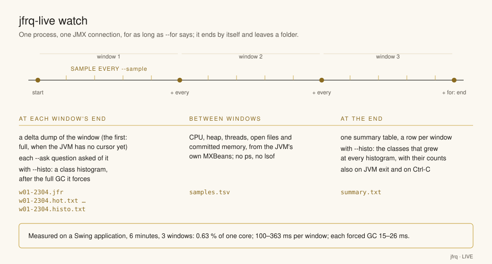

# Asking a running JVM: `jfrq-live`

`jfrq` reads a finished file. A JVM that is recording has no finished file: the recording
ends in a chunk that is still open, the JDK parser blocks on that chunk indefinitely, and
`jfrq` refuses it ([design, section 3](design/README.md#3-damaged-and-unusual-files)). To follow an application while it
runs, each question is asked of a dump. `jfrq-live` takes the dumps: it attaches to the
JVM, asks its flight recorder for a window of data, writes the window to a file, checks
what the file holds against what was asked, and runs the `jfrq` question on it.

```
jfrq-live 4242 start --max-age 10m                            # a recording in the JVM, bounded
jfrq-live 4242 full  -- stalls --thread 'event-loop-*'         # everything so far
jfrq-live 4242 delta -- stalls --thread 'event-loop-*'         # what happened since
jfrq-live 4242 delta --out t2.jfr -- alloc --baseline t1.jfr   # the rate change between two windows
jfrq-live 4242 again -- locks                                  # the previous window, another question
jfrq-live 4242 stop
```

The module is `live/`; `./gradlew installDist` puts the launcher at
`live/build/install/jfrq/bin/jfrq-live`, next to `jfrq`. It needs nothing beyond the JDK:
`jdk.attach` to reach the process and `jdk.management.jfr` to drive its recorder.

## 1. The loop

Every command takes the JVM's pid first. A `jfrq` command after `--` is run on the dump
with the dump's path inserted, so `-- stalls --thread 'x'` becomes
`jfrq stalls <dump> --thread 'x'`.

| Command | What it does | Cursor |
|---|---|---|
| `status` | The JVM's recordings (id, name, state, since when, bounds) and the cursor kept for it. | reads |
| `start` | Starts a recording: the JDK `profile` settings with the thresholds [RECORDING.md](RECORDING.md) recommends, or `--settings NAME` for another JDK profile treated the same way, or `--settings FILE.jfc` taken as it is; then `--set EVENT#SETTING=VALUE[,...]` on top. `--max-age`, `--max-size`, `--name`. | |
| `bound` | Sets `--max-age` and/or `--max-size` on the running recording; `0` removes a bound. | |
| `full` | Dumps everything the recording holds. | set to the dump's end |
| `delta` | Dumps what happened since the cursor. | moved to the dump's end |
| `again` | Dumps the previous window once more. | unchanged |
| `stop` | Stops and closes the recording; the JVM discards its data, unless the recording has a destination (`-XX:StartFlightRecording=filename=...`), where the JVM writes it before closing it. | |
| `watch` | Follows the JVM for `--for`: a window every `--every`, each `--ask` question on it, samples, `--histo`, a summary (section 7). | moved with each window |
| `histo` | The JVM's class histogram, after a full GC (section 7). | |

`--recording ID\|NAME` picks the recording when the JVM runs several; with one running
recording nothing needs saying. A name two recordings share is a usage error that lists
their ids, and `start` refuses a name the JVM already has. `--out FILE` names the dump,
replacing a file of that name; the default, `<pid>-<command>-<HHmmss.SSS>Z.jfr` in the
current directory, is stamped to the millisecond in UTC and never replaces a file. A dump is
readable by its owner only (mode 0600): a recording can hold command lines, environment
variables and system properties. `--state DIR` is where cursors live (default
`~/.jfrq/live`).

Everything that can be checked without the JVM is checked before attaching: the options,
and the `jfrq` question after `--` with the dump standing in as its recording. A typo
there costs no dump and does not move the cursor.

A dump prints three lines before the question's answer:

```
Dumped     t1.jfr  804 KB, 1 chunk, 12:23:21.688Z .. 12:23:31.077Z (9.39 s)
Window     12:23:21.689Z .. now (since the previous dump)
Cursor     next delta from 12:23:31.078Z; last window 12:23:21.689Z .. 12:23:31.077Z (~/.jfrq/live/4242.properties)
```

With `--json` in the question after `--`, these lines go to standard error instead, so
that standard output is the JSON document alone.

`Dumped` is what the file holds, read from its chunk headers (the ones `jfrq info`
starts from; the events are not parsed): size, chunks, span. `Window` is what was asked. When they differ by more than a second a line
says why (section 4). `Cursor` is where the next `delta` starts.

`start` prints what it configured: the profile it started from and every threshold,
throttle and sample period it overlaid. Without it, the settings could be checked only
with `jfrq info` on the first dump. A `--settings FILE.jfc` is taken as it is, and the
line says so instead of listing an overlay.

`--set` changes single settings without a `.jfc`, in the form `stalls` advises them:
`jfrq-live 4242 start --set jdk.ExecutionSample#period=1ms`. Several are one
comma-separated list, as in `-XX:StartFlightRecording`. The recorder takes a setting it
does not have, or a value it cannot read, without a word (on JDK 25 a period of `1 msec`
became `everyChunk`), so `start` refuses both as usage errors: a `period`, `threshold`,
`throttle`, `enabled` or `stackTrace` value it cannot read before attaching, and an
`EVENT#SETTING` the configured recording does not have once it is configured, closing the
recording again. The `Settings` line ends with what `--set` changed.

## 2. How a dump is taken

This is what `jcmd <pid> JFR.dump` does, driven over JMX instead of a diagnostic command:

1. **Clone the recording and stop the clone.** Stopping seals the chunk the JVM is
   writing at that instant `T` and starts a fresh chunk at the same `T`; the sealed chunk
   goes to the clone. The newest events are therefore in a finished chunk, and the
   recording itself keeps running untouched.
2. **Stream the clone's chunks that overlap the window** into the file, in 128 KiB blocks
   over the local JMX connector. The JVM selects whole chunks: every chunk whose
   `[start, end]` touches `[begin, end]` of the window. Events are never cut.
3. **Close the clone.** Nothing is left behind in the JVM. A dump interrupted by Ctrl-C
   or `SIGTERM` leaves nothing either:
   - A shutdown hook, in place from before the clone exists until it is closed, removes
     the partial `.part` file and closes the clone.
   - The hook waits for the JVM at most five seconds, so a target that does not answer
     (stopped with `SIGSTOP`, hung) cannot keep `jfrq-live` from exiting. The clone it
     still holds is then named on standard error with the command that closes it.
   - An interrupt while the JVM is still making the clone waits for its answer the same
     way, then closes the clone; if no answer comes, the line names the recording being
     cloned instead.
   - Only `SIGKILL`, or a JVM that does not answer, can leave a stopped clone, which pins
     its chunks until the JVM exits. `status` lists it and `stop --recording <id>` closes
     it (a recording that is not running is closed, not stopped).

The stop instant `T` is the clone's stop time, which the JVM reports in milliseconds,
and it is the exact end of the last chunk in the file. `full` and `delta` record it.

**Why the cursor is `T + 1 ms`.** The next chunk starts at the same instant `T` as the
sealed one ends, and chunk selection is inclusive at both ends, so a delta beginning at
`T` would get the sealed chunk again. One millisecond past the millisecond the JVM
reported is strictly after the sealed chunk's end and strictly inside the next chunk,
whatever the sub-millisecond part of `T` was. A delta therefore holds exactly the chunks
sealed after the previous dump: no event twice, none lost. `LiveTest.theLoop` asserts
this against a real recording: the delta's first chunk starts where the full dump's last
chunk ended.

**`again`** re-asks the last window, `[begin, T]`, from the current state of the
recording: the same chunks, unless the JVM has since discarded some of them (section 3).
The chunk that started at `T` is excluded by the same millisecond argument in reverse.
After a `full`, `begin` is where the full dump's file began, so the span check of an
`again` can tell when the JVM has discarded part of it since.

## 3. Bounds: `--max-age` and `--max-size`

Without a bound a recording keeps every chunk since it started. Each `full` dump is then
bigger than the last, and a JVM left recording overnight has hours of chunks on disk.
`jfrq-live` prints a `WARNING` on `start` and on every `full` dump while the recording
is unbounded, judged by the bounds the JVM reports, so `start --max-age 0` warns as a
`start` without bounds does. `bound` sets a bound without restarting the recording:

```
jfrq-live 4242 bound --max-age 10m
jfrq-live 4242 bound --max-age 10m --max-size 500MB
```

The JVM applies a bound at chunk rotation: when a chunk is sealed, the oldest chunks
whose end is older than `max-age`, or that push the total past `max-size`, are dropped.
Whole chunks, so the recording keeps a little more than the bound says. A `delta` is
unaffected as long as the previous dump is younger than `max-age` and what was recorded
since fits in `max-size`: the chunks it needs were sealed after the previous dump. A
`full` dump gives the bounded window rather than the recording's whole life, and an
`again` for a window older than the bound comes back shorter, which the span check
reports.

Sizes are decimal (`200MB` is 200 000 000 bytes), as every size `jfrq` prints;
`--max-age` takes a unit (`10m`, `1h`). `0`, or `--max-age infinity`, removes a bound;
`bound --max-age 0` on a recording that has no `max-size` makes it unbounded again. The
JVM keeps the age bound in whole seconds: an age under a second is a usage error (the JVM
would take it as zero, which means no bound), and a fraction is rounded up to the next
second with a note saying so. An age past 9223372036s (the largest number of seconds
whose nanoseconds fit in a `long`) is a usage error too. With deltas a minute apart, `--max-age 10m` leaves nine
minutes of margin for each delta and limits a `full` dump to the last ten minutes.

## 4. The span check

After every dump the file is read back and its span compared with the window:

| Line | Meaning |
|---|---|
| `Note  the file starts D before the window` | The first chunk that overlaps the window started earlier than the window did. Expected for a window that did not begin at a dump boundary; a dump boundary is where every `delta` begins, so a delta never says this. |
| `WARNING  the file starts D after the window: the JVM had already discarded that data (max-age ..., max-size ...)` | The window's beginning is gone from the JVM. A `delta` older than the bound, or an `again` for a window that has aged out. The answer covers what is left. |
| `WARNING  the file starts D after the window: the recording started at ..., after the window began` | The recording never held the window's beginning: it was stopped and started again (or another one picked) since the cursor was set. |
| `Note  the file ends D after the window` | `again` only, and only when a chunk boundary fell inside the last millisecond of the window: the chunk after it was taken too. |
| `WARNING  the recording has no bound` | `full` on an unbounded recording (section 3). |
| `WARNING  the file is truncated` / `its last chunk is not finished` | A damaged dump, as the chunk headers show it; `jfrq` reports the same. |

Differences under a second are chunk granularity and are not reported.

## 5. The cursor file

One properties file per pid under the state directory:

```
jvm=1789993351707                    # the JVM's start time: a reused pid after a restart is a new JVM, no cursor
cursor=2026-09-21T12:23:49.945Z      # where the next delta begins (T + 1 ms)
begin=2026-09-21T12:23:31.078Z       # the last window, for `again`; after a full dump, where its file began
end=2026-09-21T12:23:49.944Z
```

Times are UTC instants, as everything the tool prints. Deleting the file resets the
loop; so does restarting the JVM. A file that cannot be parsed is reported as damaged,
with the advice to delete it.

A save writes a temporary file beside the cursor and renames it over the old one, so a
reader sees one cursor or the other, never half of one. Two `jfrq-live` processes dumping
the same JVM take turns: a dump holds a lock on `<pid>.lock` in the same directory from
reading the cursor to advancing it, and the second one says it is waiting.

## 6. Requirements and what can go wrong

- **Same user, attach allowed.** Attaching needs the same OS user as the target and a
  target not started with `-XX:+DisableAttachMechanism`. The target's runtime must carry
  `jdk.management.agent` (every full JDK; a jlinked image may leave it out).
- **The first attach starts the JVM's local management agent**, which can take a few
  seconds; later attaches reuse it. A macOS host whose name does not resolve makes the
  JDK's own hostname lookup time out inside that start; `jfrq-live` avoids the same
  lookup on its side by naming its RMI endpoint `127.0.0.1`, but cannot do so for the
  target. The local connector talks over loopback whatever the name says.
- **No running recording**: `full` and `delta` need one. `start` one, or run the JVM
  with `-XX:StartFlightRecording` (with the settings in [RECORDING.md](RECORDING.md),
  plus `maxage=10m`).
- **Several running recordings**: name one with `--recording`. A JVM often has a
  continuous recording next to an on-demand one; `status` lists them.
- **In-memory recordings** (`disk=false`) have no chunks for a clone to hand over, so a
  dump of one fails with "holds no data in the window" and leaves no file. Recordings
  `start` makes are to disk, as are `-XX:StartFlightRecording` ones by default.

Exit status: 0 on success; 1 when the JVM cannot be attached, refuses the operation, the
connection fails, or the dump cannot be written or read back; 2 on a usage error,
including an ambiguous `--recording NAME`, a duplicate `start --name` and an invalid
question after `--`. A `jfrq` command after `--` sets the status once the dump succeeded.
A connection that does not close cleanly after a successful command is a warning on
stderr, not a failure.

## 7. Watching a JVM for a while: `watch`, `histo`, `growth`

```
jfrq-live 4242 watch --every 30m --for 2h --histo --ask health --ask "stalls --thread 'AWT-EventQueue-*'"
jfrq-live 4242 histo --out before.txt                 # one class histogram
jfrq-live growth before.txt after.txt later.txt       # the classes that grew from each to the next
```

`watch` is the loop of section 1 run by one process for a set time. It attaches once and
keeps that JMX connection for every window, sample and histogram. It ends by itself.



**Windows.** Every `--every` it takes a dump the way `delta` does (the same code: cursor,
lock, clone, span check) into `wNN-HHmm.jfr` in the output directory: `NN` is the
window's number, `HHmm` the UTC minute it ended. The first window is a `delta` from the
cursor when the JVM has one; without one it is a `full` dump, everything the recording
holds, so it can cover more than `--every`. The last window ends at `--for` and is shorter
when `--for` is not a multiple of `--every`. No window starts less than half of `--every`
after the previous one ended: a slot that close is passed over (and a last stretch that
short is left to the next `delta`). The cursor moves with every window, so a
`delta` after the watch continues where it stopped. The span check's lines are printed
for each window as `full` and `delta` print them.

**Questions.** Each `--ask` is a `jfrq` question, quoted as one argument and split as the
shell would split it; it runs on every window, and its answer, with any complaint, goes
to `wNN-HHmm.<command>.txt` (`.json` with `--json`). A second question with the same
command writes `<command>-2`. Every question is checked before attaching, as after `--`.

**Samples.** Every `--sample` (default `60s`) a row goes to `samples.tsv`, read from the
JVM's own MBeans over the same connection; no `ps` or `lsof` runs:

| Column | What it is |
|---|---|
| `time_utc` | when the row was taken |
| `process_cpu_pct` | the JVM's CPU time over the wall time since the previous row; 100 is one core busy, as `top` counts |
| `system_cpu_pct` | the whole machine's CPU use, 0 to 100 |
| `heap_used_bytes`, `heap_committed_bytes` | the heap, as `MemoryMXBean` reports it |
| `threads` | live threads |
| `open_fds` | open file descriptors (empty where the platform has no count, Windows) |
| `committed_virtual_bytes` | the process's committed virtual memory (on macOS mostly reservations: 508 GB measured for a 149 MB heap) |

The first row has no CPU values: both are rates since the previous reading. No MBean
reports the resident set size; `jfrq health` on a window reports it from the recording's
`jdk.ResidentSetSize` events, and `ps -o rss= -p <pid>` reads it beside the watch.

**Histograms.** With `--histo` the watch takes a class histogram at the start
(`w00-HHmm.histo.txt`) and after each window's dump (`wNN-HHmm.histo.txt`), through the
`DiagnosticCommand` MBean's `gcClassHistogram`, which is `jcmd <pid> GC.class_histogram`.
Each one is a full GC in the JVM first: that is what makes a histogram count reachable
objects only, and it is a pause the application sees. Measured on a Swing application with
57 to 126 MB of heap in use: a `G1Full` pause of 14.9 to 26.2 ms per histogram, seven measured. The next window records
it as a full collection with the cause `Heap Inspection Initiated GC`, and `jfrq health`
lists it as a finding; with `--histo`, a full collection of that cause is the watch's own.

**The end.** The watch ends after `--for`, at once when the JVM exits, with the time it
went, or on Ctrl-C (or `SIGTERM`), which abandons a dump in progress the way section 2
describes, waits at most ten seconds for the window in progress, and writes the summary.
Its status is 0 when no window failed, 1 when one did. The connection's close gets two
seconds, and a JVM that has exited is not asked. Every call over the connection has a
deadline: ten seconds for a sample, two minutes for a histogram, and none reaches past
`--for` plus 30 seconds, so a JVM that stops answering (frozen, swapping, held in a
debugger) ends the watch about 32 seconds after `--for` at the latest, with status 1
(measured: 52 s for `--for 20s`; a dump abandoned in flight can add the five seconds its
cleanup is given). A JVM that does not answer is connected to again once; a second time,
or a first one after `--for`, ends the watch with status 1. A window that fails on a good
connection is a line in the summary, and the next window's delta covers its time; when
the recording itself was stopped or closed, no later window can succeed, and the watch
ends there with status 1 and says so. Window slots missed while the watch was held up (a
laptop asleep, a slow call) are passed over, not taken back to back: each would cost a
dump and, with `--histo`, a full GC, and histograms taken milliseconds apart hide a class
that grows. The late window and the next one cover their time.

**The summary**, on standard output and in `summary.txt`: a row per window with its
span, file, dump size, wall time for the whole window (dump, histogram, questions), wall
time of the dump alone, and the range of the samples taken in it (process CPU, heap used,
threads, file descriptors); then failed windows, with the window whose delta covers their
time, questions that did not exit with 0, reconnects (with the gap they leave in
`samples.tsv`), skipped window slots and histograms that failed; with `--histo`, the
growth table of all the histograms.

**Its own cost**, measured with `/usr/bin/time -l` on a watch of 6 minutes, a window
every 2 minutes, a sample every 20 s, `--histo`, `--ask 'hot --app ...'` and
`--ask health`, against a Swing application, windows of 1.95 to 8.67 MB: 2.28 s of CPU
in 360.7 s (2.02 s user, 0.26 s system, 0.63 % of one core), 209 MB maximum resident set.
Each window took 100 to 363 ms of wall time, of which the dump was 41 to 74 ms; the first
window, a `full` dump of 15m07s, was the longest.

### `histo` and `growth`

`jfrq-live <pid> histo` prints the class histogram, or writes it to `--out FILE` with a
line that counts it. `jfrq-live growth H1 H2 [H3 ...]` needs no JVM: it reads histograms
in the format `jcmd` and `histo` print, oldest first, and answers with two tables, each
ranked by byte growth from the first histogram to the last, with each class's instances
and bytes in every file (`--top N` rows each, default 15):

1. The classes whose instances and bytes both grew, strictly, from each histogram to the
   next: more objects, taking more room.
2. `BYTES GREW AT EVERY STEP (instances did not)`: the classes whose bytes grew at every
   step while their instances did not, which is larger arrays or buffers rather than more
   objects. Between two histograms of the same application an hour apart, `[I` grew by
   781 KiB while its instances fell from 5,639 to 5,180; it is in this table, not the
   first.

A class absent from a histogram counts as 0 there; rows of one class name are added
together. The GC's heap filler (`[Ljdk.internal.vm.FillerElement;`,
`jdk.internal.vm.FillerObject`) is left out of both tables, with a line that says so: its
bytes follow the GC's work, not the program's, and a quiet watch saw it as the top grower. With two histograms, a step is the pair. Growth at every step, not first to
last, keeps out a class whose count or size went up and down and ended higher. The
histograms `watch --histo` takes are each after a full GC, so a class that grows at every
step grows in what is reachable.

### What each dump leaves in the JVM

A dump reads the clone through the recorder MBean's stream API (`openStream`,
`readStream`, `closeStream`), and `jfrq-live` closes every stream it opens, on success and
on every failure (`LiveTest.everyStreamADumpOpensIsClosed`). Closing releases the chunks.
The JDK keeps the closed stream object for a fixed time anyway; read in the JDK 25 source,
`jdk.jfr.internal.management.StreamManager`:

- `closeStream` closes the stream but neither removes it from the manager's map nor
  cancels its `StreamCleanupTask`.
- The task is scheduled when the stream opens, for 2 × `TIME_OUT` later (`TIME_OUT` is 200
  minutes), and removes the stream when it fires: **400 minutes after each dump**.
- The stream keeps its read buffer, one block, so each dump holds one block of the target's
  heap for 400 minutes. I set the block to 128 KiB: on a 20–27 MB dump of a live JVM, 1 MiB
  blocks took 0.24 s, 128 KiB 0.26 s and 64 KiB 0.31 s, so 128 KiB holds an eighth as much
  for 20 ms more per dump.

Measured on a JVM with nothing else allocating, with 1 MiB blocks: three dumps, and
`byte[]` grew by 1.05 MB from each histogram to the next, with one more
`StreamCleanupTask` each time. The cost is bounded by the dump rate: with 128 KiB blocks a
watch with `--every 30m` holds about 1.8 MiB at its peak (the dumps of the last 400 minutes),
one with `--every 1m` up to 50 MiB. In `growth`, a watch's own dumps show as `byte[]`
growing by about 128 KiB per window, plus one
`StreamCleanupTask`, `FinishedStream` and `RepositoryChunk` per window.

## 8. On the demo

```
netty-demo --scenario lock --duration 5m --no-jfr &      # the service, recording nothing itself
jfrq-live $! start --max-age 2m
jfrq-live $! full  --out t0.jfr -- stalls --thread 'event-loop-*'
sleep 30
jfrq-live $! delta --out t1.jfr -- locks
jfrq-live $! delta --out t2.jfr -- alloc --baseline t1.jfr
jfrq-live $! status
jfrq-live $! stop
```

The first `full` shows the `SessionRegistry` convoy that [TUTORIAL.md](TUTORIAL.md)
walks through; each `delta` shows whether it is still there, in the window since the
last look, without ever stopping the service or its recording.
